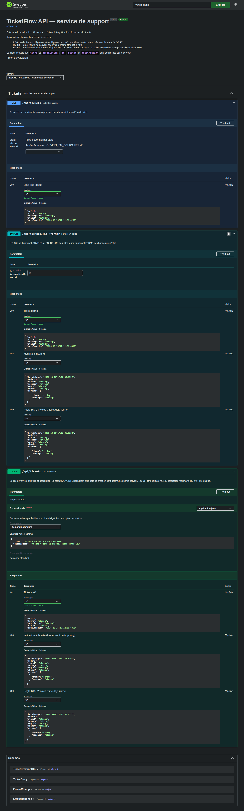
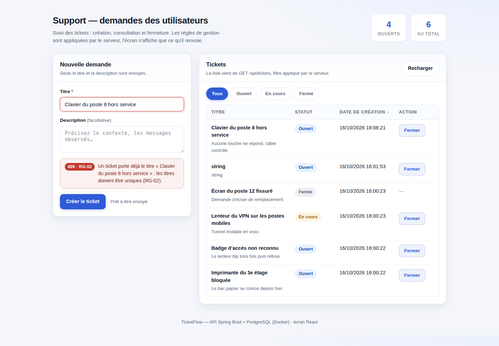
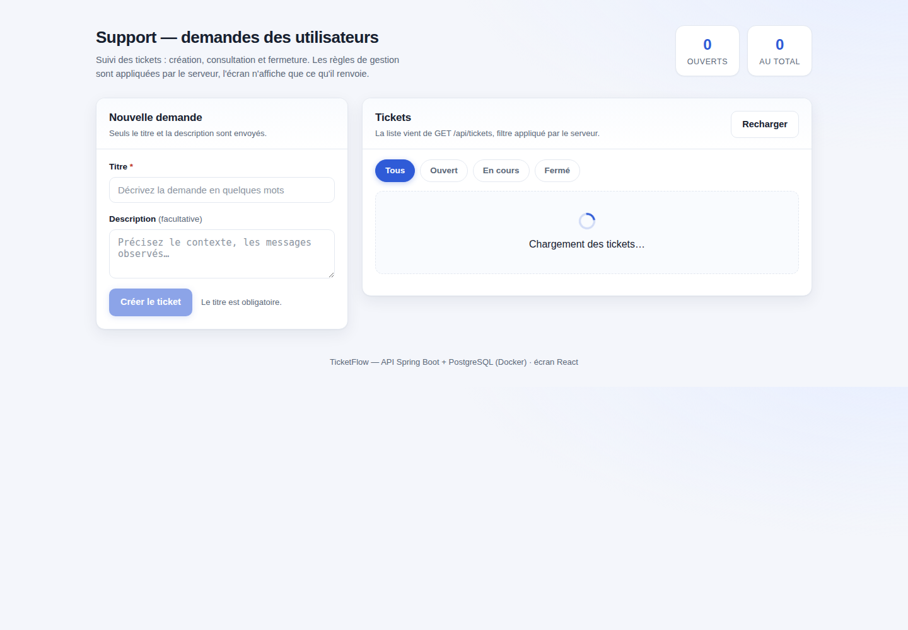
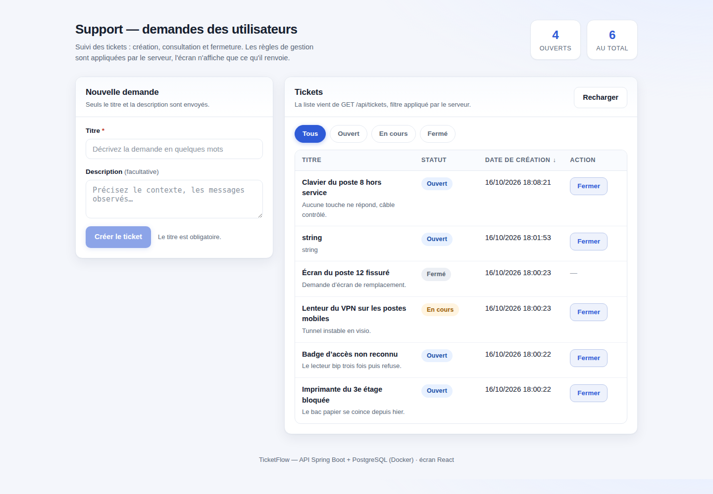
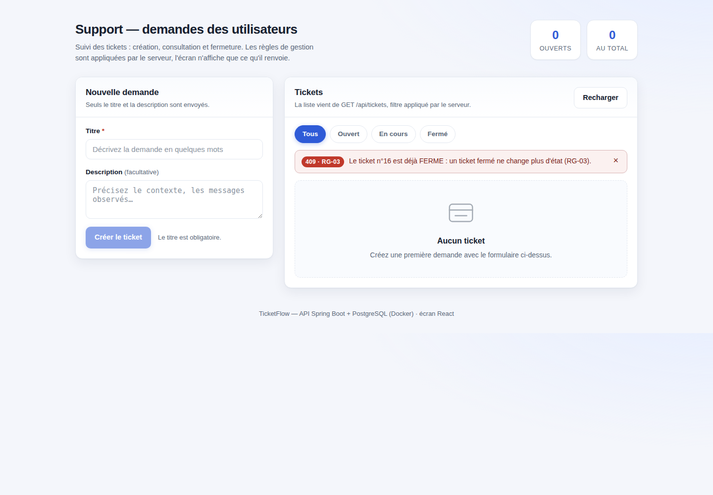
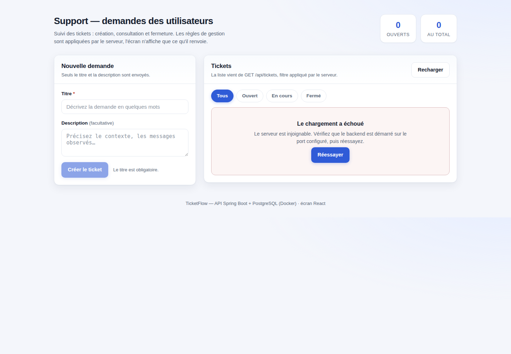
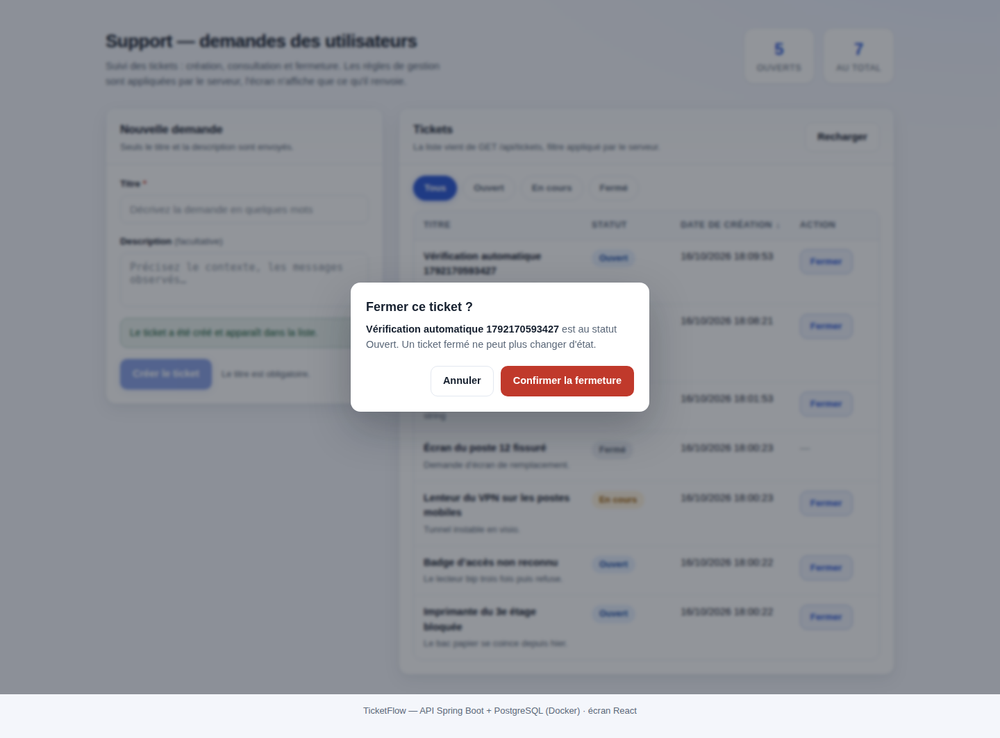

# TicketFlow — support aux utilisateurs

**KFOKAM48 · Batch 2 · Phase 3 — rattrapage des séances 1, 2 et 3 (Full Stack)**
Étudiant : **Ngansop Sumo Rainer** — matricule **221**
Branch `rattrapage/rainer-ngansop` → PR vers `main` (PR #2).

Application de gestion de tickets de support : un utilisateur déclare une demande,
le support la consulte, la filtre par statut et la ferme.
Backend **Spring Boot + PostgreSQL (Docker)**, écran **React**, API documentée sous **Swagger**.

---

## 1. Ce que l'application fait

| Écran | API |
| --- | --- |
| Liste des tickets (titre, statut, date de création, action) | `GET /api/tickets[?statut=]` |
| Filtre par statut : Tous / Ouvert / En cours / Fermé | filtre appliqué **par le serveur** |
| Formulaire de création (titre obligatoire, description facultative) | `POST /api/tickets` |
| Bouton « Fermer » avec confirmation, sur les tickets OUVERT / EN_COURS seulement | `PATCH /api/tickets/{id}/fermer` |

Aucune donnée n'est codée en dur dans l'écran : tout vient de l'API, et les refus
affichés sont **les messages du serveur**, pas des textes inventés côté client.

---

## 2. Architecture

Monolithe modulaire en couches (clean architecture) : un seul déployable, mais le
domaine ne dépend d'aucune framework. Le dossier `tickets/` contient la brique
métier, `shared/` les préoccupations transverses.

```
backend/src/main/java/com/ticketflow/
├── tickets/
│   ├── domain/          entité Ticket, enum Statut, port TicketRepository, exceptions métier
│   ├── application/     TicketService : toutes les règles de gestion, DTO entrée / DTO sortie
│   └── adapters/
│       ├── in/rest/     TicketController (+ ErreurReponse)  ← seul adaptateur HTTP entrant
│       └── out/jpa/     TicketJpaRepository (Spring Data) + JpaTicketRepositoryAdapter
└── shared/
    ├── error/           GlobalExceptionHandler (400 / 404 / 405 / 409 / 500)
    └── config/          OpenApiConfig, CorsConfig
```

Sens des dépendances : `adapters → application → domain`. L'entité JPA **ne sort
pas** du service : le contrôleur ne manipule que `TicketCreationDto` (entrée) et
`TicketDto` (sortie). Le port `TicketRepository` est défini dans le domaine et
implémenté dans `adapters/out/jpa`, donc remplacer PostgreSQL par autre chose ne
toucherait ni les règles ni le contrôleur.

```
frontend/src/
├── config/env.ts                  une seule source pour l'URL de l'API (VITE_API_URL)
├── shared/http/httpClient.ts      le SEUL endroit qui connaît fetch
├── shared/ui/Etats.tsx            chargement / vide / erreur + réessai
└── features/tickets/
    ├── domain/ticket.ts           types et règles d'affichage (peutProposerFermeture)
    ├── api/ticketApi.ts           chemin d'API et sérialisation
    ├── application/useTickets.ts  conteneur : état, appels, erreurs de formulaire/fermeture
    └── ui/                        TicketsEcran, TicketTableau, TicketFormulaire,
                                   FiltreStatutBarre, BoiteConfirmation, StatutBadge
```

Aucun composant n'appelle l'API directement — et aucun composant n'importe même un type
de la couche HTTP : les composants ne connaissent qu'`ErreurServeur`, défini dans le
domaine de la fonctionnalité. La confirmation est une boîte de dialogue accessible
(Échap, focus), jamais un `alert()` ni un `confirm()`.

---

## 3. Règles de gestion et contract HTTP

| Règle | Énoncé du sujet | Où elle est appliquée | Réponse client |
| --- | --- | --- | --- |
| **RG-01** | titre obligatoire, ≤ 100 caractères, ticket créé en `OUVERT` | `@NotBlank` / `@Size` sur le DTO + fabrique `Ticket.nouveau` | `400` + motif lisible |
| **RG-02** | deux tickets ne peuvent pas porter le même titre | `TicketService.creer` (vérification amont) + contrainte `uk_tickets_titre` | `409` + message nommant RG-02 et le titre en cause |
| **RG-03** | seuls OUVERT et EN_COURS se ferment ; un ticket FERME ne change plus | `Statut.peutEtreFerme()` + `Ticket.fermer()` + `TicketService.fermer` | `409` nommant RG-03, `404` si id inconnu |

`dateCreation` est horodatée **côté serveur** et l'entité n'a aucun setter : rien de
ce que envoie le client ne peut fixer l'identifiant, le statut ou la date.

| Méthode | Chemin | Codes documentés dans Swagger |
| --- | --- | --- |
| `POST` | `/api/tickets` | `201`, `400`, `409` |
| `GET` | `/api/tickets` | `200` (+ `400` si le filtre n'est pas un statut connu) |
| `PATCH` | `/api/tickets/{id}/fermer` | `200`, `404`, `409` |

Corps d'erreur unique (`ErreurReponse`) :

```json
{
  "horodatage": "2026-10-16T15:12:38.885Z",
  "code": 409,
  "statut": "CONFLICT",
  "message": "Un ticket porte déjà le titre « Badge d'accès » : les titres doivent être uniques (RG-02).",
  "regle": "RG-02",
  "chemin": "/api/tickets",
  "erreurs": []
}
```

---

## 4. Démarrage

### Prérequis

Docker (et docker compose), JDK 21, Node 20+.

### 1 — PostgreSQL dans un conteneur

```bash
docker compose up -d
```

Le conteneur `ticketflow-db` expose PostgreSQL 16 sur le port **5434** (5432 et 5433
étaient déjà pris sur ce poste) : base `ticketflow`, utilisateur `ticketflow`,
mot de passe `ticketflow`, volume nommé `ticketflow_data`.

### 2 — Backend

```bash
scripts/start-backend.sh          # ou : cd backend && ./mvnw spring-boot:run
```

- API : <http://localhost:8080/api/tickets>
- **Swagger : <http://localhost:8080/swagger-ui.html>** · spec : `/v3/api-docs`

Journal de démarrage attendu : **aucune ligne WARN/ERROR** (vérifié — les NOTICE de
Hibernate sur la contrainte d'unicité et les rappels de springdoc sont neutralisés
proprement, respectivement par `client_min_messages` et par le niveau de log du
package d'événements).

### 3 — Frontend

```bash
scripts/start-frontend.sh         # ou : cd frontend && npm install && npm run dev
```

Écran : <http://localhost:5173>

### Tout démarrer / tout arrêter

```bash
scripts/demarrer-tout.sh          # db + backend + frontend, avec attente des ports
scripts/stop-backend.sh           # libère 8080
scripts/stop-frontend.sh          # libère 5173
docker compose down               # arrête la base (les données restent dans le volume)
```

---

## 5. Vérification

### Tests automatisés du backend — 18 tests, tous verts

```bash
cd backend && ./mvnw test
```

- `TicketServiceTest` (9) : règles RG-01/RG-02/RG-03, 404, filtrage, au microscope Mockito ;
- `TicketControllerIntegrationTest` (9) : contrat HTTP réel sur H2 — 201 avec `Location`,
  400 sur titre absent/trop long, 409 doublon nommant la règle, liste et filtre,
  400 sur filtre inconnu, fermeture 200 puis 409, 404 sur id inconnu, et le fait que
  les champs imposés par le serveur sont ignorés s'ils sont envoyés.

### Parcours de l'écran, navigateur en tête

```bash
cd tools/verification && npm install
node verifier-1.mjs   # liste/colonnes, 400, 409, création sans rechargement, filtres, fermeture confirmée
node verifier-2.mjs   # 409 sur fermeture depuis une liste périmée, état « Aucun ticket »
node verifier-3.mjs   # backend VRAIMENT arrêté : état erreur + bouton Réessayer
node verifier-4.mjs   # indicateur de chargement pendant l'appel, réessai, base de démonstration re-remplie
node verifier-5.mjs   # page Swagger (3 endpoints + codes) et création depuis Swagger
```

Chaque script **assert** ce qu'il voit et écrit ses captures dans `tools/verification/captures/`.

### Ticket créé depuis Swagger, retrouvé en SQL (partie A.4)

```bash
docker exec ticketflow-db psql -U ticketflow -p 5434 -d ticketflow \
  -c "SELECT id, titre, statut, date_creation FROM tickets WHERE titre = 'Clavier du poste 8 hors service';"
```

```
 id |              titre              | statut |         date_creation
----+---------------------------------+--------+-------------------------------
 29 | Clavier du poste 8 hors service | OUVERT | 2026-10-16 17:32:22.395364+00
(1 row)
```

Sortie relevée sur la base de ce poste. L'identifiant dépend de l'ordre des tests ;
le titre, lui, ne change pas : c'est **l'exemple documenté sur le `POST`**
(`@ExampleObject`). `verifier-5.mjs` l'a créé en cliquant *Try it out → Execute* dans
Swagger UI — le 201 est relevé sur le réseau par le navigateur — puis est allé le
chercher **dans la table**, sans passer par l'API.
`scripts/verif-base.sql` contrôle en plus les invariants RG-01 (longueur) et RG-02 (doublons).

---

## 6. Captures

**La page Swagger des trois endpoints, avec leurs codes de retour** (exigée par le sujet) :



**Un refus 409 affiché sur l'écran** (exigé par le sujet) — message du serveur, règle nommée,
champ fautif remis en évidence, aucune `alert()` :



Les quatre états de l'écran, tels que contrôlés par le harness navigateur :

| 1. Chargement | 2. Données | 3. Liste vide | 4. Erreur (backend arrêté) |
| --- | --- | --- | --- |
|  |  |  |  |

Et la confirmation demandée **avant** l'appel de fermeture :



---

## 7. Ce qui manque, et ce que je recommande

Le sujet ne fournit **aucun endpoint pour passer un ticket en `EN_COURS`** : ce statut
n'est donc atteignable que par la base (c'est ainsi que les jeux de démonstration et
les tests le positionnent). Trois évolutions, dans l'ordre où je les ferais :

1. **`PATCH /api/tickets/{id}/statut` avec DTO de transition** — *pourquoi* : sans lui,
   `EN_COURS` est un état mort de l'API et le filtre demandé par le sujet ne sert à rien
   en production. *Coût si on attend* : chaque écran de workflow va bricoler la base.
2. **Journal des transitions (`ticket_evenement`)** — *pourquoi* : la fermeture est
   destructive pour l'historique, et un support sans date de fermeture ne peut pas
   mesurer ses délais. *Coût si on attend* : il faut rejouer l'historique, ce qui est
   impossible sans trace.
3. **Authentification et filtrage par agence** — *pourquoi* : `POST` et `PATCH` sont
   publics, donc n'importe qui peut fermer le ticket d'un autre. *Coût si on attend* :
   plus le nombre d'écrans augmente, plus reprendre la surface d'API est cher.

Deux choix faits ici méritent d'être discutés plutôt qu'avalés : la **contrainte
d'unicité en base** en plus de la vérification applicative (elle protège contre la
course entre deux requêtes concurrentes, au prix d'un `409` à retraduire depuis
`DataIntegrityViolationException`), et le **`ddl-auto: update`** pratique pour un
rendu d'exercice mais qui doit céder la place à Flyway dès qu'un schéma doit être
reproductible entre environnements.
